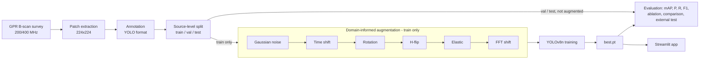
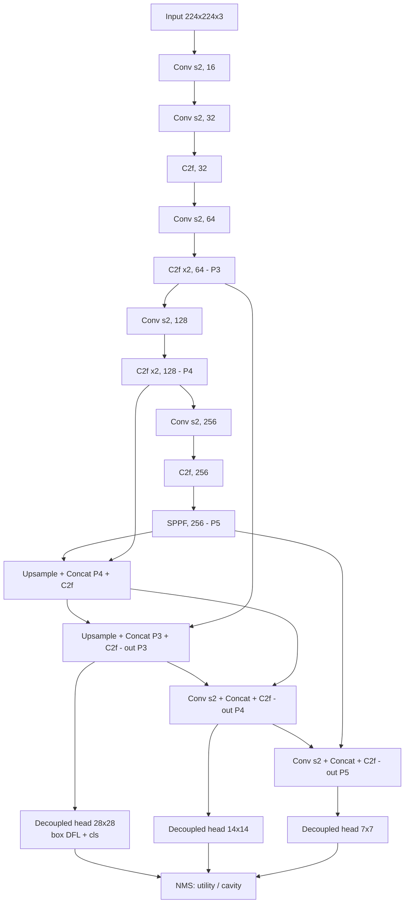

# DIAGRAMS.md: Mermaid sources (optional task)
Paste into draw.io (Arrange > Insert > Advanced > Mermaid) or mermaid.live, export as SVG/PDF for the paper.
Verify the YOLOv8n layer list against `model.info()` and `yolov8n.yaml` before finalizing.

## Project pipeline

## YOLOv8n architecture (width 0.25, depth 0.33; head scales at 224 input: 28, 14, 7)

